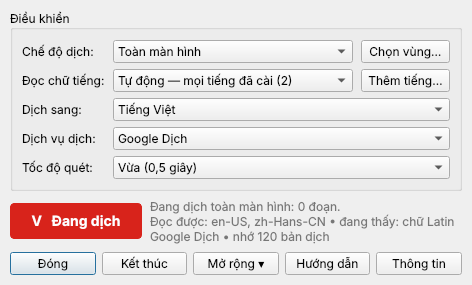

# Glossa

**Dịch trực tiếp mọi chữ trên màn hình Windows sang tiếng Việt, ngay tại chỗ.**

Glossa chạy ngầm ở khay hệ thống, giống Unikey. Nó liên tục đọc chữ trên màn hình bằng OCR có sẵn của
Windows, dịch, rồi vẽ bản dịch đè lên đúng chỗ chữ gốc, cùng cỡ chữ và cùng màu, như thể ứng dụng đó vốn
được viết bằng tiếng Việt. Dùng được với mọi ứng dụng: trình duyệt, game, phần mềm tiếng Trung/Nhật/Hàn,
phụ đề video…

### ⬇️ [Tải bản mới nhất](https://github.com/TuMo205/Glossa/releases/latest)

Tải **Glossa-Setup-….exe**, mở lên rồi bấm *Tiếp → Cài đặt*. Không cần Python, không cần quyền Admin.
Nếu Windows hiện *"Windows protected your PC"*, bấm **More info → Run anyway** (phần mềm miễn phí nên chưa
có chữ ký số trả phí). Muốn dùng không cần cài thì tải **Glossa-Portable-….zip**, giải nén rồi chạy
`Glossa.exe`.

Yêu cầu: Windows 10 (1809 trở lên) hoặc Windows 11, 64-bit, có Internet.

## Tính năng

- **Dịch liên tục, đúng chỗ:** bản dịch nằm đúng dòng của chữ gốc, đúng cỡ chữ (chữ đậm vẫn đậm), không
  chặn chuột. Bạn vẫn bấm, cuộn, gõ phím như bình thường.
- **Không giật, không nhức mắt:** chữ gốc không đổi thì bản dịch đứng yên; bản dịch mới hiện mờ dần.
- **Nhiều thứ tiếng:** đọc cùng lúc Anh, Trung, Nhật, Hàn, Nga, Ả Rập, Hy Lạp… (cài thêm gói ngay trong
  bảng điều khiển). Dịch sang tiếng Việt hoặc Anh, Trung, Nhật, Hàn, Pháp, Đức, Tây Ban Nha, Nga, Thái,
  Indonesia, Lào, Khmer.
- **Nhẹ:** màn hình đứng yên thì gần như không tốn CPU; chỉ đọc lại phần màn hình vừa thay đổi.
- **Bảng điều khiển kiểu Unikey:** biểu tượng **V đỏ** = đang dịch, **E xanh** = tạm dừng. Nhấp một lần
  để bật/tắt, nhấp đúp để mở bảng điều khiển.
- Khoanh một vùng để chỉ dịch vùng đó (phụ đề, khung chat, game).

## Phím tắt

| Phím | Tác dụng |
|---|---|
| **Ctrl+Alt+T** | Bật / tạm dừng dịch |
| **Ctrl+Alt+H** | Ẩn / hiện bản dịch |
| **Ctrl+Alt+R** | Chỉ dịch một vùng |
| **Ctrl+Alt+F** | Dịch toàn màn hình |
| **Ctrl+Alt+P** | Mở bảng điều khiển |
| **Ctrl+Alt+Q** | Thoát |

Có thể đổi phím tắt trong *Bảng điều khiển → Mở rộng*. Hướng dẫn đầy đủ: [HUONG_DAN.md](HUONG_DAN.md).

## Quyền riêng tư

Chữ đọc được trên màn hình được gửi tới **Google Dịch** để dịch. Glossa không có máy chủ riêng, không thu
thập gì khác. Bản dịch lưu trên máy chỉ gồm các chữ giao diện ngắn; không lưu đoạn văn, tin nhắn, email,
đường link hay dãy số. Khi xem nội dung nhạy cảm (ngân hàng, tin nhắn riêng…), bấm **Ctrl+Alt+T** để tạm
dừng. Mặc định bản dịch không lọt vào ảnh chụp hay phần mềm quay/chia sẻ màn hình.

## Dành cho người lập trình

- Python 3.10–3.14, PySide6, numpy, mss, Windows.Media.Ocr (pywinrt). Chạy từ mã nguồn: `CAI_DAT.bat`,
  rồi `CHAY.bat`. Kiểm thử: `python -m pytest`.
- Đóng gói: `python -m pip install -r requirements.txt pyinstaller pytest` rồi `python packaging\build.py`
  (bước tạo bộ cài cần Inno Setup 6.5+). Ra `dist\Glossa-Setup-x.y.z.exe` và `dist\Glossa-Portable-x.y.z.zip`.
- Mỗi lần đẩy mã lên `main`, [GitHub Actions](.github/workflows/build.yml) tự kiểm thử, build, chạy thử bản
  `.exe` và đăng bản cài lên trang Releases theo số phiên bản trong `glossa/__init__.py`.
